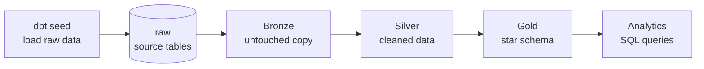
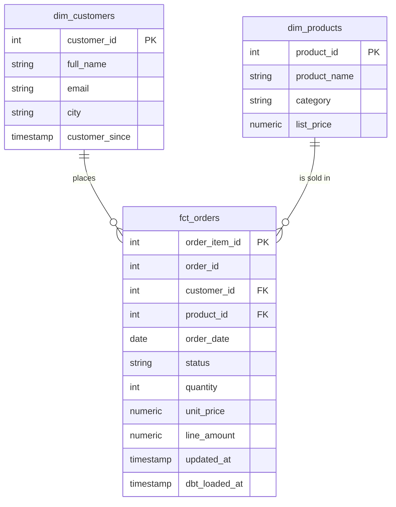
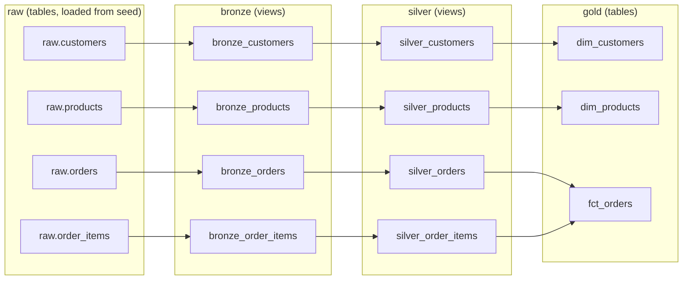
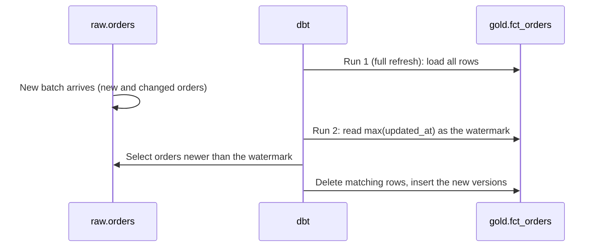
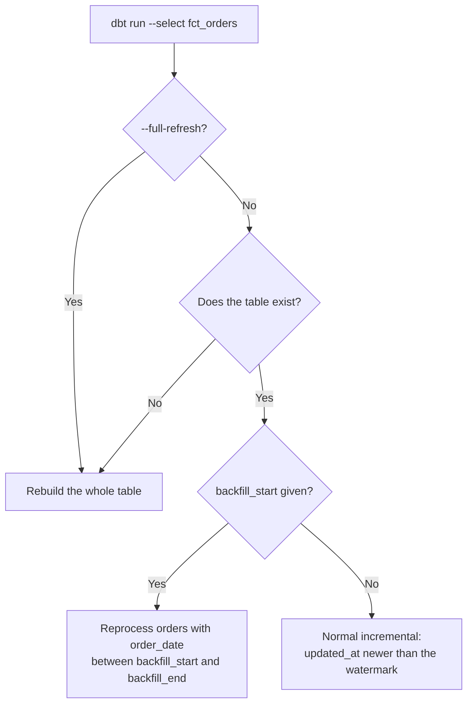

# Evaluation Milestone 1: PostgreSQL + dbt Analytics Project

A small analytical data model for a mock online shop. Raw data is loaded into a local PostgreSQL database, transformed with dbt through Bronze, Silver and Gold layers, and exposed as a star schema (one fact table and two dimensions) that SQL queries can use directly.

## Contents

1. [Project structure](#project-structure)
2. [Data lifecycle](#data-lifecycle)
3. [Data model](#data-model)
4. [How the medallion layers are implemented](#how-the-medallion-layers-are-implemented)
5. [Setup and run](#setup-and-run)
6. [Command cheat sheet](#command-cheat-sheet)
7. [Incremental models](#incremental-models)
8. [Backfill strategy](#backfill-strategy)
9. [Data freshness checks](#data-freshness-checks)
10. [Tests](#tests)
11. [SQL queries](#sql-queries)

---

## Project structure

```
eval_m1/
├── docker-compose.yml        # PostgreSQL container
├── pyproject.toml            # Python dependencies (uv)
├── dbt_project.yml           # dbt settings: layers, schemas, owners
├── profiles.yml              # dbt connection (reads values from .env)
├── seeds/
│   ├── schema.yml              # table definition of raw tables
│   └── *.csv                   # raw data for 4 tables
├── macros/
│   └── clean_text.sql             # reusable trim + lowercase
├── models/
│   ├── bronze/               # sources.yml and 4 bronze models
│   ├── silver/               # 4 silver models and schema.yml
│   └── gold/                 # dim_customers, dim_products, fct_orders, schema.yml
├── tests/                    # singular (custom SQL) tests
└── analyses/                  # analytical SQL queries
```

---

## Data lifecycle

Data moves through five stages. Each stage lives in its own PostgreSQL schema, so you can always see what each step produced.



| Stage | Schema | What happens |
|---|---|---|
| Raw | `raw` | Mock shop data is loaded using `dbt seed`. It is never modified by dbt. |
| Bronze | `bronze` | A one-to-one copy of each raw table, managed by dbt. |
| Silver | `silver` | Cleaned and standardised: spaces trimmed, emails and statuses lowercased, invalid rows removed. |
| Gold | `gold` | Analytics-ready star schema: `fct_orders`, `dim_customers`, `dim_products`. |
| Analytics | n/a | SQL queries in `Analyses/` answer business questions from the Gold tables. |

Raw data is deliberately untidy (mixed-case emails, extra spaces) so that the Silver layer has real cleaning to do.

---

## Data model

The Gold layer is a star schema. The fact table holds the numbers (quantity, amount). The dimensions describe who bought and what was bought.



| Table | Type | Grain (one row per...) |
|---|---|---|
| `gold.fct_orders` | Fact (incremental) | order item (one product line within an order) |
| `gold.dim_customers` | Dimension | customer |
| `gold.dim_products` | Dimension | product |

`line_amount` is `quantity * unit_price`. `dbt_loaded_at` records which dbt run wrote each row.

---

## How the medallion layers are implemented

Each layer is a folder under `models/`. Its materialisation, schema and owner are set once in `dbt_project.yml`, and every model in the folder inherits them.

| Layer | Folder | Schema | Built as | Owner label | Purpose |
|---|---|---|---|---|---|
| Bronze | `models/bronze` | `bronze` | view | ingestion | Copy of raw via `source()`. No changes. |
| Silver | `models/silver` | `silver` | view | data-engineering | Cleaning and standardising via `ref()`. |
| Gold | `models/gold` | `gold` | table (fact is incremental) | analytics | Star schema for analytics. |



Key points:

- **Sources:** `models/bronze/sources.yml` declares the four raw tables. Bronze models read them with `source('raw', '...')`.
- **Model dependencies:** later layers read earlier ones with `ref('...')`, so dbt builds everything in the correct order.
- **Reusable macro:** `macros/clean_text.sql` (trim and lowercase) is used by Silver models for emails and statuses.

Silver cleaning rules:

| Model | Rules |
|---|---|
| `silver_customers` | Trim and capitalise names, trim and lowercase emails, trim city, drop rows without an ID |
| `silver_products` | Trim names, drop rows without an ID or with a price of zero or less |
| `silver_orders` | Trim and lowercase status, drop rows without an ID |
| `silver_order_items` | Drop rows without an ID or with a quantity of zero or less |

---

## Setup and run


### Steps

```bash
# 1. Get the code
git clone https://github.com/gillharleen/eval_m1_seed.git
cd eval_m1_seed

# 2. Install Python packages (creates .venv, installs dbt-postgres)
uv sync
source .venv/bin/activate  

# 3. Create .env file
nano .env

# 4. Start PostgreSQL
docker compose up -d

# 5. Check dbt can connect
dbt debug

# 6. Load seed files's raw data into the raw tables
dbt seed

# 8. Build all models and run all tests
dbt build
```

---

### Build

```bash
dbt build                                 # run all models and tests, in order
dbt build --select path:models/silver     # one layer only
dbt build --select +fct_orders            # a model and everything it depends on
```

### Run (models only)

```bash
dbt run                                   # build all models
dbt run --select fct_orders               # one model
dbt run --select bronze                   # models whose path or name matches bronze
dbt run --full-refresh                    # rebuild incremental models from scratch
```

### Test

```bash
dbt test                                  # all tests
dbt test --select fct_orders              # tests for one model
dbt test --select test_type:generic       # not_null, unique, relationships
dbt test --select test_type:singular      # custom SQL tests in tests/
```

### Debug

```bash
dbt debug                                 # check profile, connection and project files
dbt parse                                 # check the project for errors
dbt compile --select fct_orders           # show the final SQL (target/compiled/...)
dbt ls                                    # list models, tests and sources
dbt ls --resource-type test               # list tests only
```

Compiled SQL is in `target/compiled/`. The SQL dbt actually executed is in `target/run/`.

### Freshness

```bash
dbt source freshness                      # check how recent the raw data is
```

### Incremental

```bash
dbt run --select fct_orders --full-refresh   # first load: all rows
# add record updates to raw orders and order_items tables
dbt run --select fct_orders                  # incremental: only new and changed rows
Run query - select dbt_loaded_at, count(*) from gold.fct_orders group by 1 order by 1;
```

### Backfill

```bash
# Window of dates to reprocess (macOS shown; on Linux use: date -d '14 days ago' +%F)
START=$(date -v-14d +%F); END=$(date -v-9d +%F)
echo $START, $END

# Reprocess only that window
dbt run --select fct_orders --vars "{backfill_start: '$START', backfill_end: '$END'}"
```

### Docs and lineage (optional)

```bash
dbt docs generate
dbt docs serve                            # opens the model documentation in a browser
```

### Reset everything and start clean

```bash
docker compose down -v                           # deletes the database and its data
docker compose up -d
dbt seed
dbt build
```

---

## Incremental models

`gold.fct_orders` is an **incremental model**. The first run loads every row. Later runs load only rows that are new or changed, so the work stays small as the data grows.

```sql
{{ config(
    materialized='incremental',
    unique_key='order_item_id',
    incremental_strategy='delete+insert'
) }}
-- ... select ...

where o.updated_at > (select max(updated_at) from {{ this }})

```

How it works:

- **Watermark:** the newest `updated_at` already in `gold.fct_orders`. A normal run takes only source rows newer than that.
- **`unique_key` with `delete+insert`:** if a row already exists, the old version is deleted and the new one inserted, so there are no duplicates.
- **`dbt_loaded_at`:** shows which dbt run wrote each row, which makes the behaviour easy to prove.



### Demo

```bash
# 1. Full load
dbt run --select fct_orders --full-refresh
Run query - "select dbt_loaded_at, count(*) from gold.fct_orders group by 1 order by 1;"
# -> one timestamp, all rows (about 750)

# 2. New batch of data
# add new records for incremental load

# 3. Incremental run
dbt run --select fct_orders
# -> the log shows INSERT 0 <small number>, only the new and changed rows

# 4. Check the result
Run query -  "select dbt_loaded_at, count(*) from gold.fct_orders group by 1 order by 1;"
# -> two timestamps; the newer one holds only the rows from run 2

# 5. No duplicates (must return 0 rows)
Run query - "select order_item_id, count(*) from gold.fct_orders group by 1 having count(*) > 1;"

# 6. Run again with no new data
dbt run --select fct_orders
# -> INSERT 0 0, nothing newer than the watermark
```

`INSERT 0 6` in the dbt log means 6 rows were inserted in that run. At this data size the runtime difference is tiny, so compare **rows processed** and the `dbt_loaded_at` batches as evidence.

---

## Backfill strategy

An incremental model can miss data: corrected history whose `updated_at` did not change, late-arriving rows, or old rows that need recalculating after a logic change. A backfill deliberately reprocesses old data.

| Option | Command | Use it when |
|---|---|---|
| Date-range backfill | `--vars "{backfill_start: '...', backfill_end: '...'}"` | Only a period of history needs fixing |
| Full backfill | `--full-refresh` | The logic changed, or everything must be rebuilt |



The model code that implements this:

```sql

    
where o.order_date >= '{{ var('backfill_start') }}'
  and o.order_date <= '{{ var('backfill_end') }}'
    
where o.updated_at > (select max(updated_at) from {{ this }})
    

```

Rows in the window are replaced through `unique_key`, and the rest of the history stays untouched.
